Full-stack product engineer in Cyprus. I build tools that live inside AI coding agents, and ship native macOS, web and game software through [Exodia Studios](https://exodiastudios.com).

  <a href="https://github.com/sponsors/MakeItEzzz555">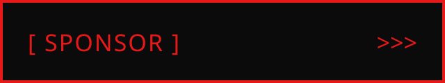</a>
  <a href="https://github.com/MakeItEzzz555?tab=followers">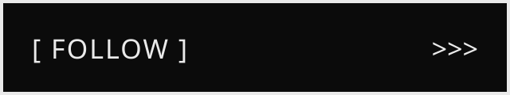</a>
  <a href="https://exodiastudios.com">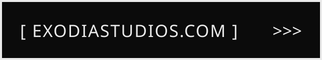</a>

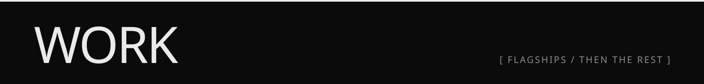

<a href="https://github.com/MakeItEzzz555/tuck-bit">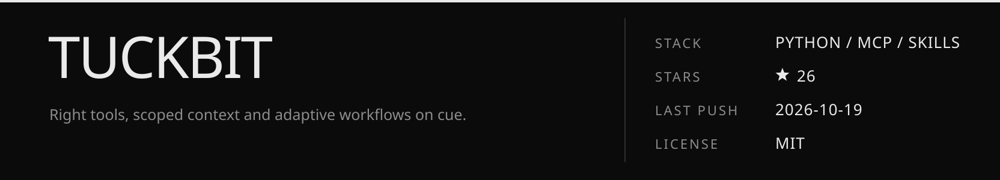</a>
<a href="https://github.com/MakeItEzzz555/tuck-bit">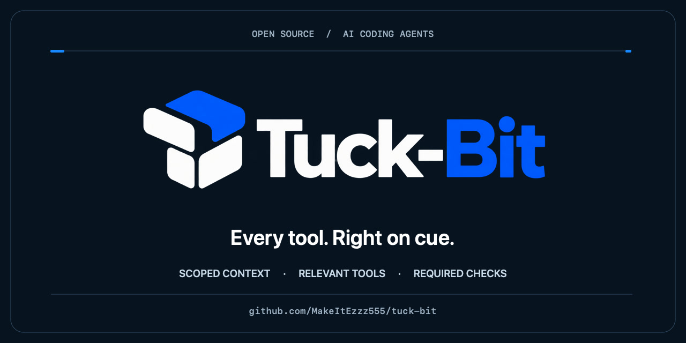</a>

<a href="https://github.com/MakeItEzzz555/Gridline">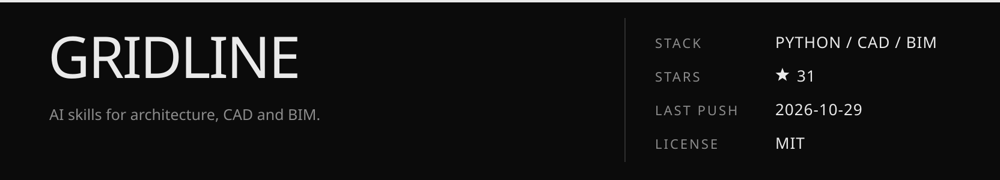</a>

https://github.com/user-attachments/assets/a397a1b3-0f50-4d00-948a-62c9537144d8

<a href="https://github.com/MakeItEzzz555/claude-widget-kit">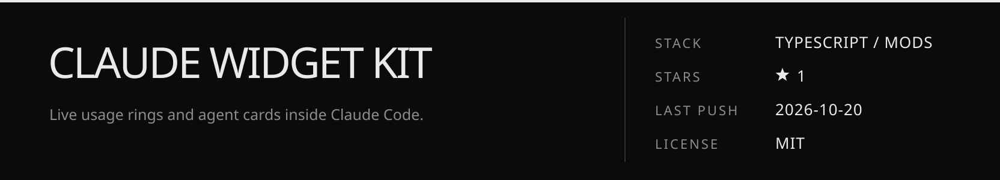</a>
<a href="https://github.com/MakeItEzzz555/claude-widget-kit">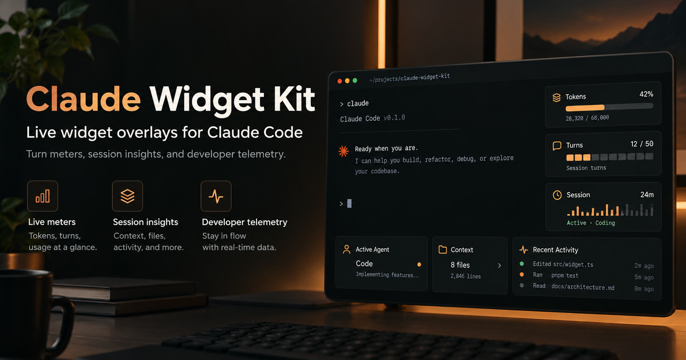</a>

  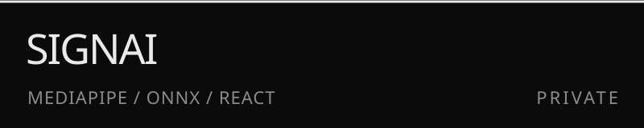
  <a href="https://github.com/MakeItEzzz555/grapharium">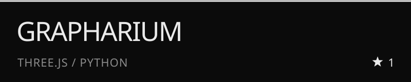</a> 
  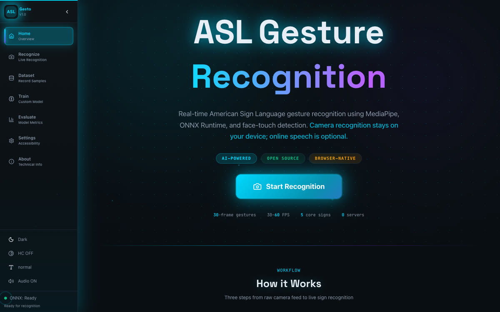
  <a href="https://github.com/MakeItEzzz555/grapharium">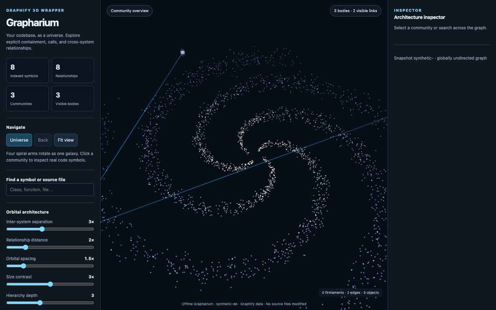</a>

  <a href="https://github.com/MakeItEzzz555/Dungeon_Escape_Project">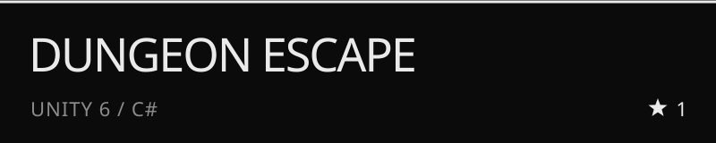</a>
  <a href="https://github.com/MakeItEzzz555/AirPTTBridge">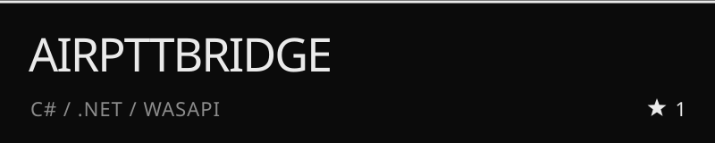</a> 
  <a href="https://github.com/MakeItEzzz555/Dungeon_Escape_Project">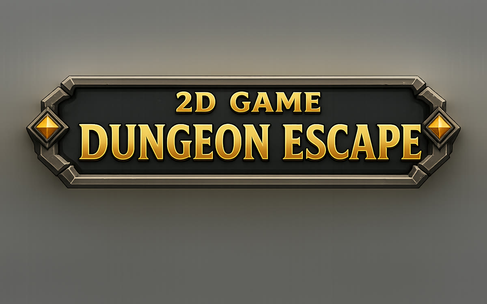</a>
  <a href="https://github.com/MakeItEzzz555/AirPTTBridge">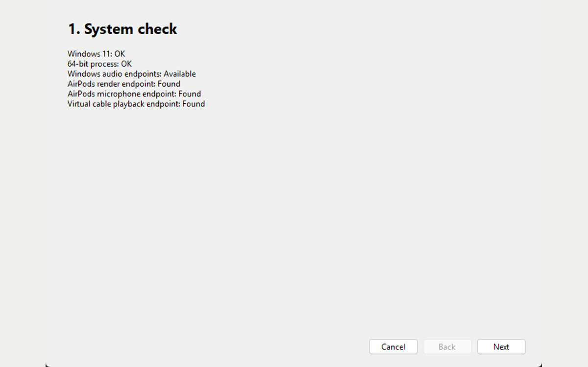</a>

  <a href="https://github.com/MakeItEzzz555/predictx">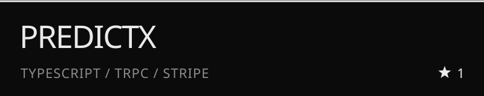</a>
  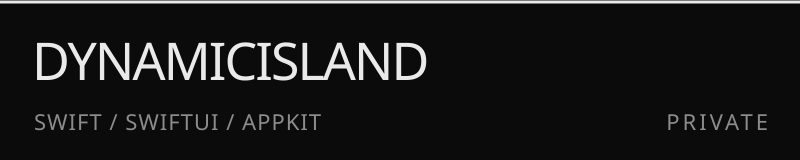

**SignAI**: ASL gesture recognition entirely in the browser, in private development. **Grapharium**: your codebase as a navigable 3D universe, offline. **Dungeon Escape**: a Unity 6 dungeon game with bosses and enemy state machines. **AirPTTBridge**: routes an AirPods mic into push-to-talk on Windows. **PredictX**: a prediction market with live order books and Stripe. **DynamicIsland**: a native macOS notch workspace, in private development.

<a href="https://exodiastudios.com">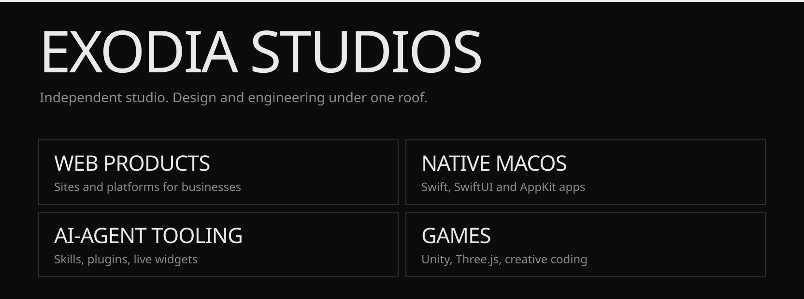</a>

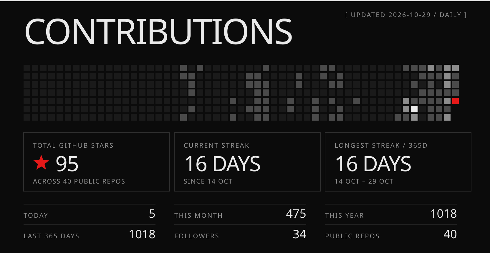

<a href="https://github.com/sponsors/MakeItEzzz555">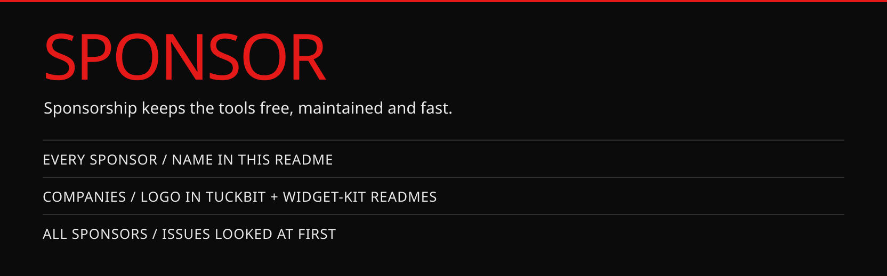</a>

  

University coursework lives in its own archive: [frederick-university-coursework](https://github.com/MakeItEzzz555/frederick-university-coursework).

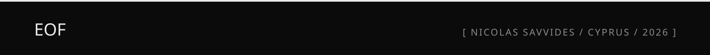
