<picture><source media="(prefers-color-scheme: dark)" srcset="./assets/signal/night/hero.svg" />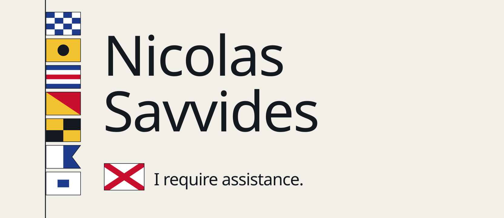</picture>

I build tools that live inside AI coding agents, and ship native macOS, web and game software through [Exodia Studios](https://exodiastudios.com). Most of it is open source.

  <a href="https://github.com/sponsors/MakeItEzzz555"><picture><source media="(prefers-color-scheme: dark)" srcset="./assets/signal/night/link-sponsor.svg" />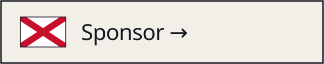</picture></a>
  <a href="https://github.com/MakeItEzzz555?tab=followers"><picture><source media="(prefers-color-scheme: dark)" srcset="./assets/signal/night/link-follow.svg" />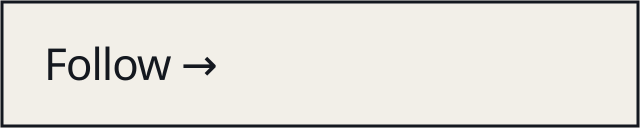</picture></a>
  <a href="https://exodiastudios.com"><picture><source media="(prefers-color-scheme: dark)" srcset="./assets/signal/night/link-studio.svg" />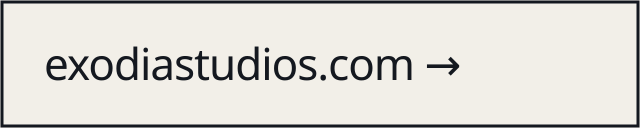</picture></a>

  
  

<picture><source media="(prefers-reduced-motion: reduce)" srcset="./assets/icons/typescript.svg" /></picture>&nbsp;&nbsp;<picture><source media="(prefers-reduced-motion: reduce)" srcset="./assets/icons/javascript.svg" /></picture>&nbsp;&nbsp;<picture><source media="(prefers-reduced-motion: reduce)" srcset="./assets/icons/python.svg" /></picture>&nbsp;&nbsp;<picture><source media="(prefers-reduced-motion: reduce)" srcset="./assets/icons/csharp.svg" /></picture>&nbsp;&nbsp;<picture><source media="(prefers-reduced-motion: reduce)" srcset="./assets/icons/openjdk.svg" /></picture>&nbsp;&nbsp;<picture><source media="(prefers-reduced-motion: reduce)" srcset="./assets/icons/cplusplus.svg" /></picture>&nbsp;&nbsp;<picture><source media="(prefers-reduced-motion: reduce)" srcset="./assets/icons/c.svg" /></picture>&nbsp;&nbsp;<picture><source media="(prefers-reduced-motion: reduce)" srcset="./assets/icons/php.svg" /></picture>&nbsp;&nbsp;<picture><source media="(prefers-reduced-motion: reduce)" srcset="./assets/icons/swift.svg" /></picture>&nbsp;&nbsp;<picture><source media="(prefers-reduced-motion: reduce)" srcset="./assets/icons/gnubash.svg" /></picture>&nbsp;&nbsp;<picture><source media="(prefers-reduced-motion: reduce)" srcset="./assets/icons/html5.svg" /></picture>&nbsp;&nbsp;<picture><source media="(prefers-reduced-motion: reduce)" srcset="./assets/icons/css3.svg" /></picture>&nbsp;&nbsp;<picture><source media="(prefers-reduced-motion: reduce)" srcset="./assets/icons/mysql.svg" /></picture>

<picture><source media="(prefers-reduced-motion: reduce)" srcset="./assets/icons/react.svg" /></picture>&nbsp;&nbsp;<picture><source media="(prefers-reduced-motion: reduce)" srcset="./assets/icons/nextdotjs.svg" /></picture>&nbsp;&nbsp;<picture><source media="(prefers-reduced-motion: reduce)" srcset="./assets/icons/nodedotjs.svg" /></picture>&nbsp;&nbsp;<picture><source media="(prefers-reduced-motion: reduce)" srcset="./assets/icons/vite.svg" /></picture>&nbsp;&nbsp;<picture><source media="(prefers-reduced-motion: reduce)" srcset="./assets/icons/tailwindcss.svg" /></picture>&nbsp;&nbsp;<picture><source media="(prefers-reduced-motion: reduce)" srcset="./assets/icons/flask.svg" /></picture>&nbsp;&nbsp;<picture><source media="(prefers-reduced-motion: reduce)" srcset="./assets/icons/dotnet.svg" /></picture>&nbsp;&nbsp;<picture><source media="(prefers-reduced-motion: reduce)" srcset="./assets/icons/unity.svg" /></picture>&nbsp;&nbsp;<picture><source media="(prefers-reduced-motion: reduce)" srcset="./assets/icons/threedotjs.svg" /></picture>&nbsp;&nbsp;<picture><source media="(prefers-reduced-motion: reduce)" srcset="./assets/icons/arduino.svg" /></picture>&nbsp;&nbsp;<picture><source media="(prefers-reduced-motion: reduce)" srcset="./assets/icons/git.svg" /></picture>&nbsp;&nbsp;<picture><source media="(prefers-reduced-motion: reduce)" srcset="./assets/icons/github.svg" /></picture>&nbsp;&nbsp;<picture><source media="(prefers-reduced-motion: reduce)" srcset="./assets/icons/visualstudiocode.svg" /></picture>&nbsp;&nbsp;<picture><source media="(prefers-reduced-motion: reduce)" srcset="./assets/icons/onnx.svg" /></picture>&nbsp;&nbsp;<picture><source media="(prefers-reduced-motion: reduce)" srcset="./assets/icons/tensorflow.svg" /></picture>

<picture><source media="(prefers-color-scheme: dark)" srcset="./assets/signal/night/work.svg" />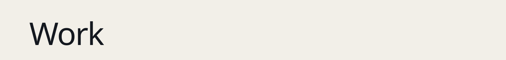</picture>

<a href="https://github.com/MakeItEzzz555/tuck-bit"><picture><source media="(prefers-color-scheme: dark)" srcset="./assets/signal/night/plate-tuckbit.svg" />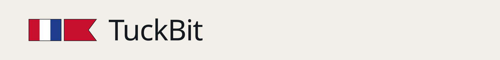</picture></a>
<a href="https://github.com/MakeItEzzz555/tuck-bit"><picture><source media="(prefers-color-scheme: dark)" srcset="./assets/work/tuckbit-dark.jpg" />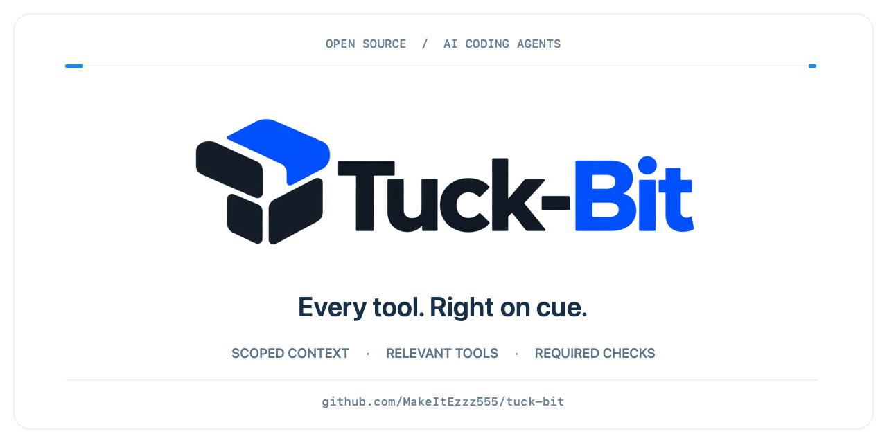</picture></a>

**TuckBit** gives Codex, Claude, Gemini and other coding agents the right tools, scoped context and adaptive workflows on cue. Portable skills and plugins, one install. 

<a href="https://github.com/MakeItEzzz555/claude-widget-kit"><picture><source media="(prefers-color-scheme: dark)" srcset="./assets/signal/night/plate-claude-kit.svg" />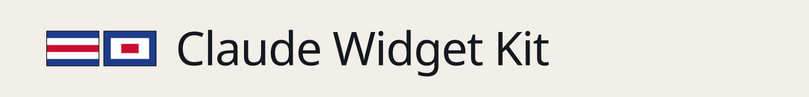</picture></a>

**Claude Widget Kit** draws live usage rings, an effort meter, task ETA and an agents panel right inside Claude Code. [Website](https://makeitezzz555.github.io/claude-widget-kit/) 

<a href="https://github.com/MakeItEzzz555/codex-widget-kit"><picture><source media="(prefers-color-scheme: dark)" srcset="./assets/signal/night/plate-codex-kit.svg" />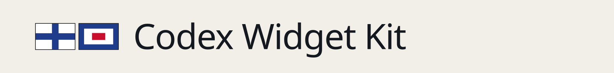</picture></a>
<a href="https://github.com/MakeItEzzz555/codex-widget-kit">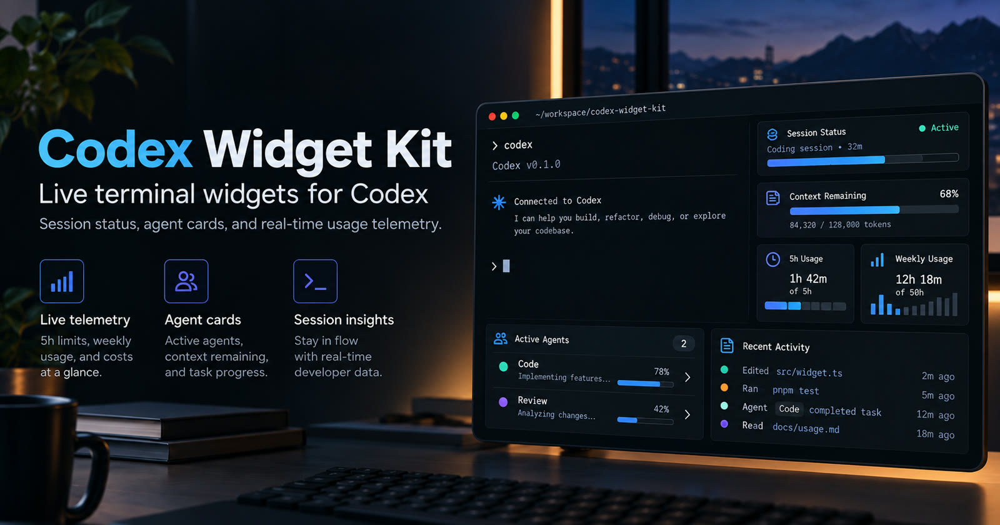</a>

**Codex Widget Kit** brings the same live gauges and sub-agent cards to the Codex CLI in their own terminal pane. Zero dependencies, read-only. [Website](https://makeitezzz555.github.io/codex-widget-kit/) 

  <a href="https://github.com/MakeItEzzz555/signai-asl-gesture-demo"><picture><source media="(prefers-color-scheme: dark)" srcset="./assets/signal/night/tag-signai.svg" />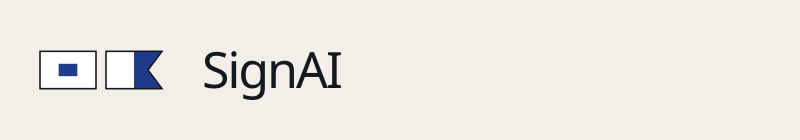</picture></a>
  <a href="https://github.com/MakeItEzzz555/grapharium"><picture><source media="(prefers-color-scheme: dark)" srcset="./assets/signal/night/tag-grapharium.svg" />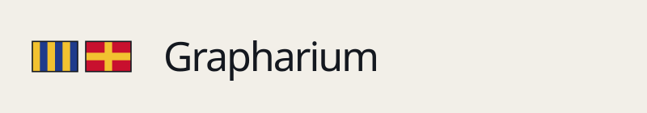</picture></a> 
  
  

  <a href="https://github.com/MakeItEzzz555/Dungeon_Escape_Project"><picture><source media="(prefers-color-scheme: dark)" srcset="./assets/signal/night/tag-dungeon.svg" />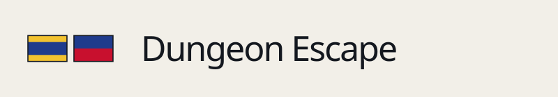</picture></a>
  <a href="https://github.com/MakeItEzzz555/AirPTTBridge"><picture><source media="(prefers-color-scheme: dark)" srcset="./assets/signal/night/tag-airptt.svg" />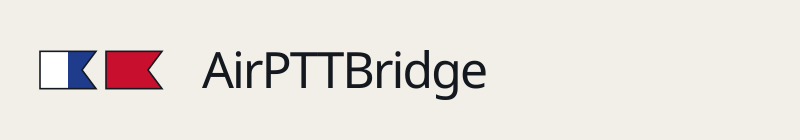</picture></a> 
  
  

  <a href="https://github.com/MakeItEzzz555/predictx"><picture><source media="(prefers-color-scheme: dark)" srcset="./assets/signal/night/tag-predictx.svg" />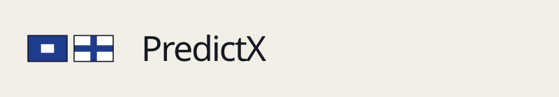</picture></a>
  <picture><source media="(prefers-color-scheme: dark)" srcset="./assets/signal/night/tag-dynamicisland.svg" />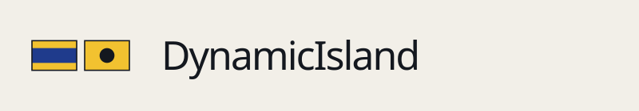</picture> 
  <a href="https://github.com/MakeItEzzz555/predictx"><picture><source media="(prefers-color-scheme: dark)" srcset="./assets/signal/night/frame-predictx.svg" />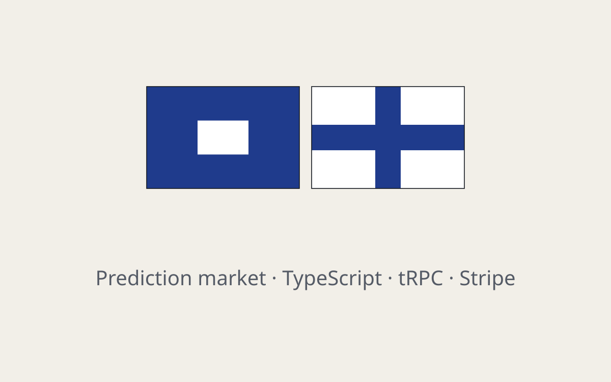</picture></a>
  <picture><source media="(prefers-color-scheme: dark)" srcset="./assets/signal/night/frame-dynamicisland.svg" />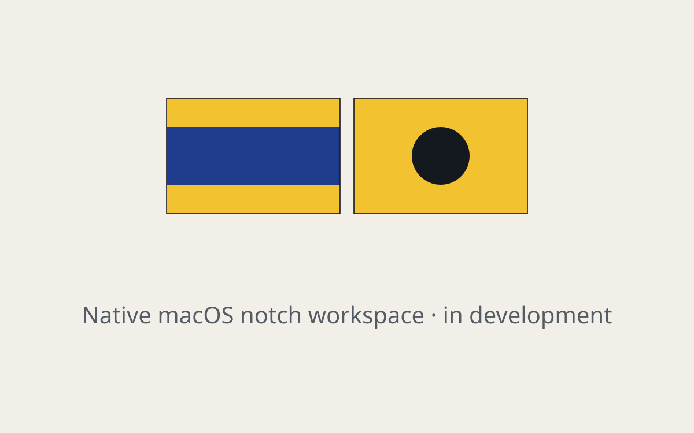</picture>

**SignAI**: ASL gesture recognition that runs entirely in the browser (MediaPipe, ONNX Runtime Web). **Grapharium**: your codebase as a navigable 3D universe, offline. **Dungeon Escape**: a Unity 6 dungeon game with bosses and enemy state machines. **AirPTTBridge**: routes an AirPods mic into push-to-talk on Windows. **PredictX**: a prediction market with live order books and Stripe. **DynamicIsland**: a native macOS notch workspace, in private development.

<a href="https://exodiastudios.com"><picture><source media="(prefers-color-scheme: dark)" srcset="./assets/signal/night/studio.svg" />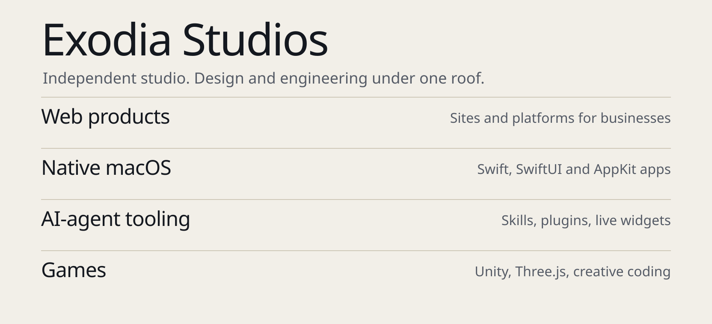</picture></a>

  <a href="https://exodiastudios.com"><picture><source media="(prefers-color-scheme: dark)" srcset="./assets/signal/night/link-studio.svg" /></picture></a>

<picture><source media="(prefers-color-scheme: dark)" srcset="./assets/signal/night/log.svg" />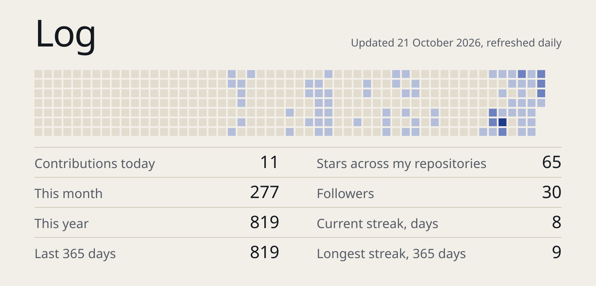</picture>

<picture><source media="(prefers-color-scheme: dark)" srcset="https://streak-stats.demolab.com?user=MakeItEzzz555&hide_border=true&border_radius=0&background=0D1630&stroke=A5ADC2&ring=9DB2EC&fire=F2C230&currStreakNum=EEF0F4&sideNums=EEF0F4&currStreakLabel=EEF0F4&sideLabels=A5ADC2&dates=A5ADC2" /></picture>

<a href="https://github.com/sponsors/MakeItEzzz555"><picture><source media="(prefers-color-scheme: dark)" srcset="./assets/signal/night/sponsor.svg" />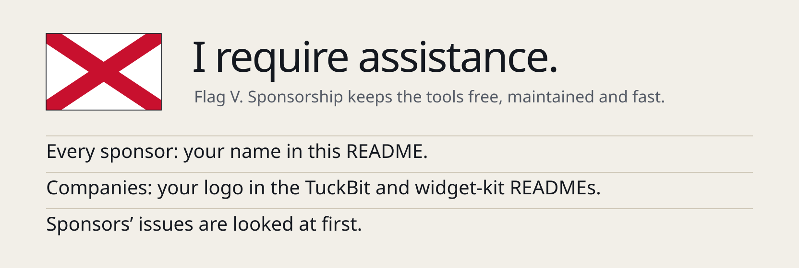</picture></a>

  <a href="https://github.com/sponsors/MakeItEzzz555"><picture><source media="(prefers-color-scheme: dark)" srcset="./assets/signal/night/link-sponsor.svg" /></picture></a>

University coursework lives in its own archive: [frederick-university-coursework](https://github.com/MakeItEzzz555/frederick-university-coursework).

<picture><source media="(prefers-color-scheme: dark)" srcset="./assets/signal/night/close.svg" />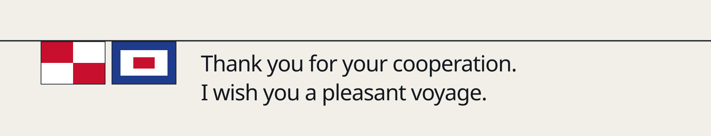</picture>
